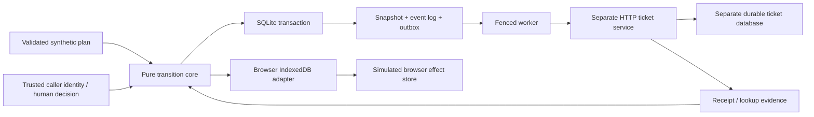

# Architecture and state invariants

## One transition core, two persistence adapters

`src/core.ts` contains canonical hashing, plan/policy validation, role checks, transition semantics, budgets, approval binding, receipt matching, and append-only history checks. It imports no Node or browser storage APIs. The web bundle imports this same module; the build records its source digest in `build.json`.

`src/sqlite.ts` stores a canonical snapshot, append-only event rows, and an outbox row in a single SQLite transaction. The worker releases the database transaction before network I/O. `src/connector.ts` implements a closed, loopback-only synthetic ticket API, backed by a different SQLite database. The integration suite launches this API in a separate process.

`src/indexeddb.ts` supplies browser transaction/CAS/lease behavior and a separate effect transaction. All identities and external-system boundaries in that adapter are simulated. The browser page itself can be edited by its owner and is not a security perimeter.

## Invariants

1. A plan has 4–16 nodes, unique bounded IDs, no missing dependencies/cycles, one proposal, one ticket action, and one receipt verification. Every research node must precede the proposal.
2. A node executes only after all dependencies complete. Only registered node kinds exist; plans are data, never executable source.
3. Every transition verifies the previous event chain, checks caller tenant/role, and appends new evidence. `completed` and `denied` are terminal.
4. The independent approver must have a different principal ID from the creator and all worker principals observed in this run. The embedding application must authenticate these principal IDs and roles; this library does not.
5. The approval binding includes run, tenant, node, exact argument payload digest, tool contract (including version/cost/idempotency), and current policy. Editing arguments, policy, or contract invalidates queued approval. Expiry is evaluated again at dispatch.
6. Approval and outbox enqueue persist atomically. Dispatch admission, budget reservation, attempt increment, and `inflight` persist atomically before calling the remote system.
7. Runtime snapshot/log/outbox updates must match the expected revision and live lease owner/fence. Time is read after acquiring the SQLite write lock. Expired owners cannot renew, checkpoint, or release a successor's lease.
8. At most three dispatch attempts are admitted; retrying an idempotent action reserves its synthetic cost once. Each admitted dispatch still consumes a step.
9. A completion/reconciliation receipt must match tenant, stable idempotency key, and approved payload digest. `verify` requires a persisted matched receipt.
10. Non-idempotent interrupted actions enter `unknown` and cannot be automatically dispatched again. Only an independent review role can reconcile evidence; there is no “assume success” or “retry anyway” transition.

## Where authorization takes effect

The atomic transition to `inflight` (`dispatch.started`) is the authorization linearization point. It reads the current policy, action, approval, and time under the database write lock. The worker checks its lease again before invoking the connector.

A network call is not part of the SQLite transaction. A revocation or lease expiry after admission cannot recall a request already admitted or sent. Fencing rejects the stale worker's later checkpoint, while connector idempotency protects the synthetic remote effect. This runtime makes no stronger claim about arbitrary APIs or real-time cancellation.

The public API allows injected clocks for deterministic tests. Production embedding must use a trusted monotonic-enough wall-clock source, never user-provided timestamps. A backwards event timestamp is rejected. This lab is a single-host SQLite runtime, not a distributed-clock protocol.

## Crash matrix

| Interruption                                | Durable runtime | Remote system             | Recovery                                                                                        |
| ------------------------------------------- | --------------- | ------------------------- | ----------------------------------------------------------------------------------------------- |
| Before admission                            | Pending outbox  | No write                  | Validate current approval/policy and admit normally.                                            |
| After admission, before remote write        | Inflight        | No receipt                | For an idempotent connector, move to pending and retry the same key after authorization checks. |
| After remote commit, before acknowledgement | Inflight        | Ticket + digest           | Lookup verifies matching receipt; checkpoint existing effect.                                   |
| After acknowledgement, before checkpoint    | Inflight        | Ticket + digest           | Same lookup path; no second write.                                                              |
| After checkpoint                            | Delivered       | Ticket + digest           | Complete dependent verification node.                                                           |
| Interrupted non-idempotent dispatch         | Inflight        | May or may not have acted | Enter unknown. Reviewer must query and reconcile exact remote evidence.                         |

The fixture's idempotency table and ticket insertion commit together. Reusing an existing key with a changed digest is rejected even if the caller changes the requested idempotency mode. The connector’s request/response bodies are byte-bounded; responses use streaming limits and fatal UTF-8 decoding.

## Integrity versus authenticity

Events include sequence, timestamp, actor/role, event type/data, previous hash, and SHA-256 hash. The adapter compares persisted event rows and outbox with the snapshot. SQLite triggers reject event updates/deletes through the normal schema. This detects corruption or partial edits; it is **not a signed audit log**. A privileged store owner can replace tables, snapshots, and hashes coherently.

The current library trusts its persistence adapter, connector implementation, and authenticated principal source. Receipt fields are evidence from the configured connector, not cryptographically signed assertions. The browser uses locally stored synthetic receipts.

## Verification and limitations

`npm test` includes pure transition invariants, SQLite durability/atomic rollback, actual competing worker processes, actual HTTP lost acknowledgements, process crashes, bounded response parsing, and IndexedDB adapter contract tests through `fake-indexeddb`. The latter does not substitute for real-browser testing.

`npm run evaluate` reruns five integration scenarios and emits environment-scoped observed evidence. It is a failure-mode demonstration, not proof of production reliability, statistical model quality, or general exactly-once delivery. The system deliberately has one side-effect node per plan; extending it requires per-action outboxes, independent reservations, and explicit compensation policy.
